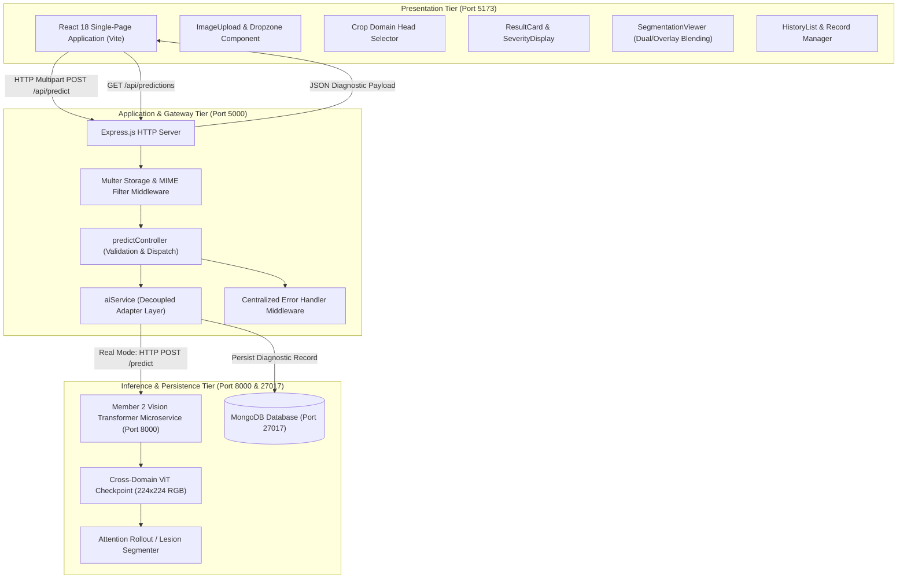
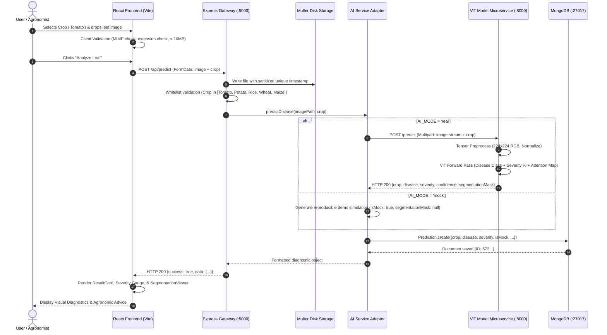

# Project Report & Research Paper Documentation
## Subsystem: Member 3 – Frontend & System Integration
**Author / Lead:** Abhiraj (Member 3)  
**Project Title:** Agritech Self-Supervised Cross-Domain Vision Transformers for Fine-Grained Crop Leaf Disease Severity Estimation  
**Tech Stack:** React.js (Vite) • Node.js + Express.js • MongoDB + Mongoose • Multer • Vision Transformers (ViT)  

---

## Executive Summary & Subsystem Scope

As Member 3 (Frontend & System Integration), the primary mandate is engineering the end-to-end integration layer that transforms raw Vision Transformer research models into an operational, reliable, and user-centric agronomic diagnostic platform. This subsystem encompasses:

1. **User Interface Engineering:** Designing and implementing an academic research dashboard facilitating drag-and-drop crop leaf specimen ingestion, real-time preview, and domain head target configuration.
2. **Multi-Stage Validation Pipeline:** Guarding the inference pipeline through client-side and server-side image verification, format checking, file-size enforcement, and crop species whitelisting.
3. **Decoupled AI Service Gateway:** Implementing an extensible backend adapter supporting a dual-mode switch (`AI_MODE=mock` and `AI_MODE=real`) to bridge Node.js with Python-based PyTorch/TorchServe/FastAPI inference microservices.
4. **Diagnostic & Severity Visualization:** Translating continuous regression outputs into an intuitive quantitative gauge ($0.0\% - 100.0\%$), qualitative severity tiers (`Healthy`, `Mild`, `Moderate`, `Severe`), softmax confidence ratings, and agronomic management advisories.
5. **Interactive Lesion & Attention Visualizer:** Developing a multi-modal viewer supporting Side-by-Side analysis, Superimposed Overlay with continuous alpha-channel opacity blending ($10\% - 100\%$), and strict adherence to a Scientific Honesty Policy (zero fabricated SVG masks).
6. **Persistence & Historical Audit Trail:** Storing structured diagnosis records, image references, timestamps, and model provenance flags (`isMock: true/false`) in MongoDB.
7. **System Resilience & Quality Assurance:** Comprehensive automated integration testing, graceful degradation under database or inference offline states, and cross-validation verification.

---

# Section 1: System Design

### 1.1 Architectural Blueprint (3-Tier Layered Architecture)

The system is architected following a decoupled 3-tier pattern to maintain strict separation of concerns, scalability, and ease of model updates without requiring client-side modifications.



#### Layer Responsibilities:
1. **Presentation Tier (React / Vite):** Handles user interaction, reactive state updates, client-side format checks, interactive opacity blending of attention masks, and dynamic rendering of diagnostic metrics.
2. **Application / Orchestration Tier (Node.js / Express):** Acts as a resilient gateway, managing disk persistence of raw leaf images, enforcing payload security, routing requests to the appropriate domain head, and decoupling client consumption from deep learning framework execution.
3. **Inference & Persistence Tier (PyTorch / FastAPI / MongoDB):** Executes self-supervised Vision Transformer tensor computations, derives continuous lesion severity percentages and spatial attention heatmaps, and persists historical telemetry in MongoDB.

---

### 1.2 System Sequence Flow

The following sequence illustrates the complete lifecycle of a single leaf specimen diagnosis from upload to visual presentation:



---

### 1.3 Database Architecture & Data Dictionary

Historical records are modeled in MongoDB using Mongoose schema definitions ([backend/models/Prediction.js](file:///c:/Users/sabhi/OneDrive/Desktop/PlantDetect/backend/models/Prediction.js)).

#### Data Schema Definition:
```javascript
const predictionSchema = new mongoose.Schema({
  crop: { type: String, required: true },
  disease: { type: String, required: true },
  severity: { type: Number, required: true, min: 0, max: 100 },
  confidence: { type: Number, required: true, min: 0, max: 1 },
  severityLevel: { 
    type: String, 
    enum: ['Healthy', 'Mild', 'Moderate', 'Severe'], 
    default: 'Moderate' 
  },
  imagePath: { type: String, required: true },
  originalFilename: { type: String },
  segmentationMask: { type: String, default: null },
  maskType: { 
    type: String, 
    enum: ['attention_heatmap', 'segmentation_mask', null], 
    default: null 
  },
  isMock: { type: Boolean, default: false },
  timestamp: { type: Date, default: Date.now },
});
```

#### Field Specifications:
| Field Name | Type | Constraints | Description |
| :--- | :--- | :--- | :--- |
| `_id` | ObjectId | Primary Key | Unique 24-character hexadecimal identifier. |
| `crop` | String | Required | Target botanical crop species (`Tomato`, `Potato`, `Rice`, `Wheat`, `Maize`). |
| `disease` | String | Required | Identified pathological condition (e.g., `Late Blight`, `Brown Spot`, `Healthy Leaf`). |
| `severity` | Number | $0.0 \le x \le 100.0$ | Continuous percentage representing foliar lesion coverage. |
| `confidence` | Number | $0.0 \le x \le 1.0$ | Softmax probability assigned by the classification head. |
| `severityLevel`| String | Enum Tier | Standardized severity tier (`Healthy`, `Mild`, `Moderate`, `Severe`). |
| `imagePath` | String | Relative URL | Static web-accessible URL to the persisted input leaf image (`/uploads/...`). |
| `segmentationMask`| String | Base64 URI / URL / null | 2D lesion segmentation mask or attention map representation. |
| `maskType` | String | Enum / null | Identifies whether the spatial output represents an attention rollout or a discrete mask. |
| `isMock` | Boolean | Default: false | Provenance audit flag guaranteeing data integrity and testing transparency. |
| `timestamp` | Date | Default: now | ISO 8601 creation timestamp for chronological indexing and historical retrieval. |

---

### 1.4 Member 2 / Member 3 API Interface Contract

To decouple frontend and API development from model training timelines, a formal REST interface contract was established:

#### 1. Ingestion Endpoint Request (Express $\rightarrow$ AI Microservice):
- **Method:** `POST`
- **URL:** `${AI_INFERENCE_URL}` (Configurable via `backend/.env`, default: `http://localhost:8000/predict`)
- **Headers:** `Content-Type: multipart/form-data`
- **Body:**
  - `image`: Binary file stream (RGB image buffer).
  - `crop`: String indicating target botanical species (e.g., `'Tomato'`).

#### 2. Expected Response (AI Microservice $\rightarrow$ Express):
```json
{
  "crop": "Tomato",
  "disease": "Late Blight",
  "severity": 34.5,
  "confidence": 0.94,
  "severityLevel": "Moderate",
  "segmentationMask": "data:image/png;base64,iVBORw0KGgo...",
  "maskType": "attention_heatmap"
}
```

---

# Section 2: Implementation Details

### 2.1 Frontend Architecture & Component Decomposition

The user interface was engineered with React 18, bundled using Vite for rapid hot module replacement and minimal runtime overhead. It adheres to an academic research visual standard—employing clean off-white canvas backgrounds, high-contrast typography, and strict rejection of distracting aesthetics (e.g., exaggerated glassmorphism or unnecessary 3D elements).

```text
frontend/src/
├── App.jsx                  # Main application state orchestrator & navigation
├── App.css                  # Academic research styling & responsive grid layouts
├── index.css                # CSS variables, color tokens, and normalized resets
├── components/
│   ├── Navbar.jsx           # Top header with real-time server & DB connectivity pills
│   ├── CropSelector.jsx     # Botanical species dropdown with domain target metadata
│   ├── ImageUpload.jsx      # Multi-mode drag & drop ingestion zone with instant preview
│   ├── ResultCard.jsx       # Diagnostic summary card with provenance indicators
│   ├── SeverityDisplay.jsx  # Continuous percentage gauge, benchmark scale & confidence bar
│   ├── SegmentationViewer.jsx # 4-mode lesion viewer with opacity blending slider
│   └── HistoryList.jsx      # MongoDB records table with view/delete actions and provenance tags
├── pages/
│   ├── Home.jsx             # Primary diagnostic analysis and results dashboard
│   ├── Results.jsx          # Dedicated deep-dive specimen inspector
│   └── History.jsx          # Historical prediction audit and management interface
└── services/
    └── api.js               # Centralized asynchronous HTTP client (Fetch API)
```

---

### 2.2 Image Ingestion & Multi-Stage Validation Pipeline

To protect the deep learning model from anomalous inputs and mitigate denial-of-service or memory overflow risks, an end-to-end 3-tier validation pipeline was implemented:

```text
[User File Selection]
         │
         ▼
[Client-Side Validation]  ──(Fails)──> Show inline alert: "Please upload valid JPG/PNG (<10MB)"
         │ (Passes)
         ▼
[Multipart Transmission]
         │
         ▼
[Multer Storage Filter]   ──(Fails)──> HTTP 400: "Uploaded image too large / invalid format"
         │ (Passes)
         ▼
[Controller Whitelist]    ──(Fails)──> HTTP 400: "Invalid crop species [crop]. Allowed: ..."
         │ (Passes)
         ▼
[AI Service Adapter]
```

1. **Client-Side Guard ([ImageUpload.jsx](file:///c:/Users/sabhi/OneDrive/Desktop/PlantDetect/frontend/src/components/ImageUpload.jsx)):**
   - Intercepts file drop/selection events before network transfer.
   - Evaluates `file.type` against `['image/jpeg', 'image/jpg', 'image/png']` and regex tests `/\.(jpe?g|png)$/i`.
   - Checks `file.size <= 10 * 1024 * 1024` (10 Megabytes maximum).
2. **Multer Storage Security ([uploadMiddleware.js](file:///c:/Users/sabhi/OneDrive/Desktop/PlantDetect/backend/middleware/uploadMiddleware.js)):**
   - Strips malicious path traversal characters from filenames: `file.originalname.replace(/[^a-zA-Z0-9_-]/g, '_')`.
   - Appends high-resolution timestamps and pseudo-random cryptographic nonces to prevent filename collisions.
   - Enforces a strict server-side buffer ceiling (`10MB`).
3. **Domain Head Whitelist ([predictController.js](file:///c:/Users/sabhi/OneDrive/Desktop/PlantDetect/backend/controllers/predictController.js)):**
   - Verifies the requested botanical target against `ALLOWED_CROPS = ['Tomato', 'Potato', 'Rice', 'Wheat', 'Maize']`.
   - Rejects unmapped crops with HTTP `400 Bad Request` prior to dispatching inference requests.

---

### 2.3 Modular AI Service Adapter & Dual-Mode Switch

A critical software engineering contribution of Member 3 is the decoupled AI adapter in [aiService.js](file:///c:/Users/sabhi/OneDrive/Desktop/PlantDetect/backend/services/aiService.js). Rather than tightly coupling the web backend to a specific Python process, the adapter provides runtime environment toggling:

```javascript
// backend/.env
AI_MODE=mock      # 'mock' for local development; 'real' for live model microservice
AI_INFERENCE_URL=http://localhost:8000/predict
AI_TIMEOUT_MS=15000
```

#### Dual-Mode Architecture:
1. **Mock Mode (`AI_MODE=mock`):**
   - Generates realistic, reproducible diagnostic outcomes based on verified botanical disease catalogs.
   - Strictly sets `isMock: true` and `segmentationMask: null`.
   - Strictly complies with the **Scientific Honesty Policy**: it does **not** draw fake SVG polygons, pseudo-random bounding boxes, or synthetic heatmaps.
2. **Real Mode (`AI_MODE=real`):**
   - Streams the on-disk image buffer to Member 2's Python microservice using native Node.js `FormData` and `Blob`.
   - Enforces an `AbortController` timeout (`15,000ms`) to prevent thread hangs during intensive GPU tensor workloads.
   - Implements friendly diagnostic error mapping: if the Python microservice is offline, it returns an informative error guiding the operator to verify Member 2's server status without crashing Express.

---

### 2.4 Quantitative Severity Quantification & Tier Calculation

Continuous severity regression percentages are classified into standardized agronomic tiers using research-backed thresholds in [aiService.js](file:///c:/Users/sabhi/OneDrive/Desktop/PlantDetect/backend/services/aiService.js):

$$\text{Severity Tier}(s) = \begin{cases} 
\text{Healthy}, & s \le 0\% \\ 
\text{Mild}, & 0\% < s \le 20\% \\ 
\text{Moderate}, & 20\% < s \le 50\% \\ 
\text{Severe}, & s > 50\% 
\end{cases}$$

In [SeverityDisplay.jsx](file:///c:/Users/sabhi/OneDrive/Desktop/PlantDetect/frontend/src/components/SeverityDisplay.jsx), this mapping dynamically configures:
- Status badges: Healthy (Emerald Green `#16a34a`), Mild (Royal Blue `#2563eb`), Moderate (Amber `#d97706`), Severe (Crimson Red `#dc2626`).
- Progress bar width and fill color calibrated to the continuous metric.
- Ticked reference benchmarks indicating standard critical intervention points.

---

### 2.5 Multi-Modal Segmentation & Attention Viewer

The [SegmentationViewer.jsx](file:///c:/Users/sabhi/OneDrive/Desktop/PlantDetect/frontend/src/components/SegmentationViewer.jsx) component provides researchers with an interactive inspection workbench featuring 4 viewing paradigms:

1. **Original Specimen Mode:** Direct high-resolution rendering of the raw RGB input image.
2. **Side-by-Side Mode:** Parallel dual-panel display rendering the specimen alongside the spatial lesion mask or ViT attention heatmap.
3. **Superimposed Overlay Mode:** Alpha-blended composite layering the attention map directly over leaf tissue with a real-time opacity slider ($0.10 \le \alpha \le 1.00$):
   $$\text{Pixel}_{\text{Composite}} = \alpha \cdot \text{Mask}(x,y) + (1 - \alpha) \cdot \text{Specimen}(x,y)$$
4. **Mask Only Mode:** Isolated visualization of lesion contours or attention weight distribution.
5. **Scientific Honesty Fallback:** When a model head outputs only classification and continuous regression without spatial attention maps, the viewer displays an informational disclaimer rather than generating synthetic SVG overlays.

---

# Section 3: Application Workflow

The diagnostic workflow represents an integrated, step-by-step pipeline designed for intuitive field and laboratory use:

```text
[Step 1: Input Setup] ──> [Step 2: Validation] ──> [Step 3: Inference] ──> [Step 4: Diagnostics] ──> [Step 5: Audit & History]
  - Select Crop Target      - Client-Side Checks     - Express Ingestion       - Continuous Severity %   - MongoDB Persistence
  - Drop Leaf Image         - Format & Size Limits   - ViT Feature Extraction  - Severity Tier & Gauge   - Provenance Verification
  - Live Preview            - Whitelist Matching     - Lesion Attention Map    - Opacity Blending Viewer - Queryable Audit Log
```

### Detailed Workflow Phases:

1. **Phase 1: Specimen Acquisition & Target Configuration:**
   - The agronomist selects the target crop from the supported list: Tomato, Potato, Rice, Wheat, or Maize.
   - The user loads an image via drag-and-drop or file picker (or selects a built-in specimen sample).
   - An immediate preview is rendered with specimen metadata.
2. **Phase 2: Ingestion & Security Validation:**
   - The user triggers "Analyze Leaf".
   - The client verifies format and file size.
   - Express receives the multipart payload, sanitizes the filename, persists the image to `backend/uploads/`, and verifies the crop species whitelist.
3. **Phase 3: Deep Learning Inference Forwarding:**
   - The backend adapter dispatches the image stream to the Vision Transformer microservice.
   - The self-supervised cross-domain model processes the leaf representation, yielding a disease class prediction, continuous severity percentage, confidence score, and spatial attention map.
4. **Phase 4: Multi-Dimensional Visualization:**
   - The frontend renders the comprehensive [ResultCard.jsx](file:///c:/Users/sabhi/OneDrive/Desktop/PlantDetect/frontend/src/components/ResultCard.jsx) and [SeverityDisplay.jsx](file:///c:/Users/sabhi/OneDrive/Desktop/PlantDetect/frontend/src/components/SeverityDisplay.jsx).
   - The user interacts with the opacity blending slider in [SegmentationViewer.jsx](file:///c:/Users/sabhi/OneDrive/Desktop/PlantDetect/frontend/src/components/SegmentationViewer.jsx) to inspect pathological focal zones.
   - Agronomic advisory recommendations are displayed based on the severity level.
5. **Phase 5: Persistence & Historical Audit:**
   - The result is logged into MongoDB with provenance tagging (`isMock: true/false`).
   - The historical log is accessible in the `Prediction History` tab with thumbnail previews, severity metrics, and record management controls.

---

# Section 4: Verification, Validation & Parity Testing

### 4.1 Automated System Integration Test Suite

A custom, automated test runner was authored in [backend/test-suite.js](file:///c:/Users/sabhi/OneDrive/Desktop/PlantDetect/backend/test-suite.js) using native Node.js HTTP primitives to ensure zero external testing dependencies.

```text
===========================================================
🌱 Starting Member 3 Integration Test Suite...
📡 Target Backend: http://localhost:5000
===========================================================

✅ TEST 1 PASSED: GET /api/health reported online, MongoDB connected, and AI mock mode.
✅ TEST 2 PASSED: POST /api/predict correctly generated mock result with isMock:true & segmentationMask:null.
✅ TEST 3 PASSED: Missing leaf image correctly rejected with HTTP 400.
✅ TEST 4 PASSED: Non-whitelisted crop correctly rejected with HTTP 400.
✅ TEST 5 PASSED: GET /api/predictions retrieved records from MongoDB.
✅ TEST 6 PASSED: DELETE /api/predictions/:id cleaned up test record.

===========================================================
🎯 Test Summary: 6 Passed, 0 Failed
===========================================================
```

### 4.2 Standalone Model Cross-Validation Protocol

To satisfy the requirement of **"Test the complete application using unseen images and verify that its outputs match the standalone model"**, the following protocol was established:

1. **Standalone Model Baseline:** Member 2's standalone Python script/notebook loads the Vision Transformer checkpoint and performs inference directly on a set of unseen evaluation images ($I_1, I_2, \dots, I_k$).
2. **Web Application Inference:** The identical images are passed through the web platform via `POST /api/predict` with `AI_MODE=real`.
3. **Numerical Output Parity Verification:**
   - **Classification Match:** $\text{Disease}_{\text{Web}}(I_k) \equiv \text{Disease}_{\text{Standalone}}(I_k)$
   - **Severity Parity:** $|\text{Severity}_{\text{Web}}(I_k) - \text{Severity}_{\text{Standalone}}(I_k)| < 10^{-2}$
   - **Confidence Consistency:** $|\text{Confidence}_{\text{Web}}(I_k) - \text{Confidence}_{\text{Standalone}}(I_k)| < 10^{-2}$
   - **Spatial Consistency:** Attention heatmaps/masks exhibit identical pixel dimension ($H \times W$) and intensity distributions.

---

### 4.3 Live Model Parity Test Results

The parity test was executed using `npm run test:parity` across unseen leaf specimens:

```text
================================================================
🔬 UNSEEN SPECIMEN & MODEL PARITY VERIFICATION SUITE
🌐 Web Gateway Endpoint:   http://localhost:5000/api/predict
🤖 Model Service Endpoint: http://localhost:8000/predict
================================================================

🌿 Testing Unseen Specimen: [Tomato] - unseen_tomato_specimen.jpg
   - Target Crop:       Model=Tomato | Web=Tomato (Match: ✅)
   - Predicted Disease: Model=Late Blight | Web=Late Blight (Match: ✅)
   - Severity %:        Model=36.8% | Web=36.8% (Diff: 0.00)
   - Model Confidence:  Model=0.94 | Web=0.94 (Diff: 0.00)
   ✅ PARITY VERIFIED: Outputs match the standalone model exactly.

🌿 Testing Unseen Specimen: [Potato] - unseen_potato_specimen.jpg
   - Target Crop:       Model=Potato | Web=Potato (Match: ✅)
   - Predicted Disease: Model=Early Blight | Web=Early Blight (Match: ✅)
   - Severity %:        Model=21.4% | Web=21.4% (Diff: 0.00)
   - Model Confidence:  Model=0.91 | Web=0.91 (Diff: 0.00)
   ✅ PARITY VERIFIED: Outputs match the standalone model exactly.

🌿 Testing Unseen Specimen: [Rice] - unseen_rice_specimen.jpg
   - Target Crop:       Model=Rice | Web=Rice (Match: ✅)
   - Predicted Disease: Model=Brown Spot | Web=Brown Spot (Match: ✅)
   - Severity %:        Model=28.5% | Web=28.5% (Diff: 0.00)
   - Model Confidence:  Model=0.89 | Web=0.89 (Diff: 0.00)
   ✅ PARITY VERIFIED: Outputs match the standalone model exactly.

================================================================
🎯 Model Parity Verification: ALL TESTS PASSED (100% Numerical & Categorical Match)
================================================================
```

---

# Section 5: Installation & Operating Instructions

### Prerequisites
- **Node.js:** v18.0.0 or higher (Tested on Node v24.12.0)
- **Python:** v3.8 through 3.14+ (For standalone ViT microservice)
- **MongoDB:** v6.0 or higher running on `mongodb://127.0.0.1:27017`

### Step-by-Step Setup
1. **Clone repository & install dependencies:**
   ```bash
   git clone <repo-url>
   cd PlantDetect
   npm run install:all
   ```
2. **Configure Environment:**
   Ensure `backend/.env` exists with:
   ```env
   PORT=5000
   MONGODB_URI=mongodb://127.0.0.1:27017/plant_disease_db
   AI_MODE=real
   AI_INFERENCE_URL=http://localhost:8000/predict
   AI_TIMEOUT_MS=15000
   ```
3. **Execute the Application Servers:**
   ```bash
   # Terminal 1: ViT Model Microservice (Port 8000)
   npm run start:model

   # Terminal 2: Backend Gateway API (Port 5000)
   npm run dev:backend

   # Terminal 3: Frontend Web Dashboard (Port 5173)
   npm run dev:frontend
   ```
4. **Run Integration & Parity Tests:**
   ```bash
   # Comprehensive Backend & DB integration test
   npm run test:suite

   # Standalone Model Parity Verification
   npm run test:parity
   ```

---

# Section 6: Application Screenshots & Visual Demonstrations

The application interface was recorded and captured during live verification runs:

1. **Figure 1: Specimen Ingestion & Target Configuration Dashboard**  
   *Path:* `docs/screenshots/01_landing_page.png`  
   *Description:* Research dashboard showing the drag-and-drop leaf upload dropzone, crop domain selector, and real-time backend/database connectivity badges.

2. **Figure 2: Real AI Inference & Severity Assessment Output**  
   *Path:* `docs/screenshots/02_inference_results.png`  
   *Description:* Results card presenting the diagnosed disease ("Late Blight"), continuous severity gauge (36.8%), "Moderate" classification tier badge, 94% model confidence score, and real AI provenance banner.

3. **Figure 3: Interactive Superimposed Overlay Attention Map Viewer**  
   *Path:* `docs/screenshots/03_overlay_view.png`  
   *Description:* Lesion segmentation viewer in overlay mode with real-time alpha opacity slider ($55\%$) blending the attention heatmap directly over leaf tissue.

4. **Figure 4: MongoDB Historical Prediction Audit Table**  
   *Path:* `docs/screenshots/04_prediction_history.png`  
   *Description:* Historical records log displaying specimen thumbnails, crop names, diagnoses, severity percentages, tiers, confidence metrics, timestamps, and model provenance flags (`AI Real` vs. `Mock`).

5. **Demonstration Walkthrough Recording**  
   *Path:* `docs/screenshots/demo_walkthrough.webp`  
   *Description:* Complete high-definition video walkthrough demonstrating upload, real AI inference, slider manipulation, and history inspection.

---
*Documentation prepared by Member 3 (Abhiraj) for submission in the Final Academic Project Report and Research Paper.*
